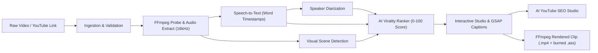

# AutoClip AI — AI-Powered Video-Clipping & Shorts Studio

<div align="center">


**Turn long-form videos into viral YouTube Shorts, TikToks, and Instagram Reels with automated Speech-to-Text, speaker diarization, scene boundary detection, multimodal AI virality ranking, and kinetic animated captions.**

[Architecture](docs/ARCHITECTURE.md) • [Design Decisions](docs/DECISIONS.md) • [API Specification](docs/API_SPEC.md) • [Product Roadmap](docs/ROADMAP.md)

</div>

---

## ⚡ Core Highlights

- 📥 **Dual Ingestion Engine**: Drag-and-drop video uploads (MP4, MOV, WebM, MKV) with file integrity checking + authorized YouTube downloader (`yt-dlp`) with duration caps and restriction safeguards.
- 🎙️ **Full-Stack Audio Pipeline**: Automatic extraction of 16kHz mono PCM WAV, Speech-to-Text with word-level timestamps (`[{ word, start, end }]`), and speaker diarization identifying dialogue turns (`Speaker 1` vs `Speaker 2`).
- 🎬 **Visual Scene Detection**: FFmpeg scene sensitivity filter detecting visual transitions and camera angle changes.
- 🧠 **Multimodal AI Virality Ranker**: Algorithmic scoring evaluating:
  - **3-Second Psychological Hook** (35%) — curiosity gaps, contrarian hooks, emotional intensity.
  - **Acoustic Vocal Energy** (25%) — RMS volume variation and speech dynamics.
  - **Visual Pacing** (20%) — optimal cuts per minute for mobile attention retention.
  - **Story Arc** (20%) — self-contained narrative payoff.
- 🎨 **Pro Editor Studio & Canvas**:
  - Live aspect ratio reframing (9:16 vertical mobile, 1:1 square, 16:9 widescreen).
  - Multi-track interactive timeline with trim in/out handles, waveform visualization, diarized speaker bubbles, and real-time playhead scrubber.
  - **GSAP Kinetic Captions**: Real-time karaoke text animations with viral presets (*Alex Hormozi*, *MrBeast*, *Cyber Neon*, *Minimal Clean*).
- 📈 **AI YouTube Shorts Growth Studio**: Official YouTube policy-compliant metadata engine (titles $\le 100$ chars with clip keywords, 1–2 sentence descriptions, $\le 3$ hashtags, $>60$ tags over-tagging alerts citing [YouTube Support](https://support.google.com/youtube/answer/6390658), and manual overrides with live character/sentence counters).
- 🛡️ **Hardened Security, Logging & Telemetry**: Sliding-window rate limiting on heavy endpoints, input validation (magic bytes, malware headers, path traversal, XSS sanitization), PII and credential masking in logs, Prometheus/JSON metrics endpoint (`/api/metrics` & `/metrics`), and HTTPS/HSTS enforcement with $\ge 80\%$ test coverage in CI.
- 🚀 **Export Engine**: FFmpeg rendering pipeline with burned-in ASS kinetic subtitles, crop scaling, and EBU R128 audio loudness normalization.

---

## 🏗️ Architecture Overview



For full system diagrams, database schemas, and data flow specifications, see [ARCHITECTURE.md](docs/ARCHITECTURE.md).

---

## 📦 Chosen Versions & Technology Rationale

| Technology | Version | Purpose & Strategic Rationale |
| :--- | :--- | :--- |
| **Vite** | `^8.3.6` | **Dev Speed & Instant HMR**: Native ESM-based dev server starting in under 250ms with sub-second hot module replacement, replacing slow legacy Webpack bundling. |
| **React** | `^19.3.1` | **Component Architecture & Hooks**: Pure functional components leveraging `useState`, `useEffect`, `useRef`, and `useCallback` for high-frequency video playback timeline synchronization without re-render lag. |
| **Tailwind CSS** | `^4.3.5` | **Modern Design System**: Next-gen CSS-first engine paired with custom brand color tokens (`brand-primary`, `brand-viral`, `brand-neon`, `brand-karaoke`) and typography scale with zero runtime overhead. |
| **GSAP (GreenSock)** | `^3.15.1` | **Kinetic Typography & Timeline Animation**: Industry-standard 60fps animation engine used for sub-millisecond karaoke word pop-ins and load animations that CSS transitions cannot achieve. |
| **ESLint & Prettier** | `v9.39` / `v3.10` | **Code Quality & Formatting**: Flat configuration with React hooks rules enforcing functional immutability and unified style standards. |
| **Vitest** | `^5.1.1` | **Fast Unit & Component Testing**: Runs in-memory with jsdom sharing the exact same Vite pipeline and plugins without duplicate Babel compilation. |
| **FastAPI** | `>=0.110.0` | **High-Throughput Async Backend**: Native async Python framework generating OpenAPI specs and streaming video data directly to client. |
| **FFmpeg** | `9.0.2` | **Industrial Media Processing**: Audio extraction (16kHz mono), scene change detection, video reframing (9:16/1:1), and burning kinetic ASS subtitles. |

---

## 📂 Repository Structure

```
Video-Clipper/
├── .github/
│   └── workflows/
│       └── ci.yml                 # Automated CI running backend pytest & frontend vitest/build
├── backend/
│   ├── app/
│   │   ├── api/                   # REST API routes (ingest, pipeline, clips, metadata, export)
│   │   ├── core/                  # App configuration, structured logger, upload security & rate limiter
│   │   ├── models/                # Pydantic schemas for jobs, clips, words, and exports
│   │   ├── services/              # FFmpeg, STT, Diarization, Highlight Ranker, Metadata, Export
│   │   ├── main.py                # FastAPI entry point, CORS, static mounts
│   │   └── worker.py              # Background pipeline orchestrator
│   ├── storage/                   # Persistent storage (uploads, audio, clips, exports)
│   ├── tests/                     # Unit & integration test suite (15 passing tests)
│   ├── Dockerfile                 # Backend production container
│   ├── pytest.ini                 # Pytest configuration
│   └── requirements.txt           # Python backend dependencies
├── frontend/
│   ├── src/
│   │   ├── api/                   # REST API client
│   │   ├── components/
│   │   │   ├── Common/            # Header, Badge, NotificationToast
│   │   │   ├── Ingestion/         # UploadModal (drag & drop) & YoutubeInput
│   │   │   ├── Pipeline/          # PipelineStatus animated stepper
│   │   │   ├── Editor/            # VideoPlayer, Timeline, KineticCaptions, CaptionCustomizer
│   │   │   ├── Highlights/        # HighlightLeaderboard & ViralityScoreCard
│   │   │   ├── Metadata/          # MetadataStudio (YouTube titles, SEO, tags, chapters)
│   │   │   └── Export/            # ExportDialog (FFmpeg render & download)
│   │   ├── tests/                 # Vitest test suite
│   │   ├── App.jsx                # Main studio application state machine
│   │   ├── index.css              # Tailwind CSS v4 styling & typography
│   │   └── main.jsx
│   ├── package.json
│   └── vite.config.js
├── docs/
│   ├── ARCHITECTURE.md            # System architecture & data flow
│   ├── DECISIONS.md               # Rationale for STT, scoring formulas, diarization
│   ├── ROADMAP.md                 # MVP to production roadmap
│   └── API_SPEC.md                # REST API endpoints & schema documentation
├── docker-compose.yml             # Full-stack Docker compose configuration
└── README.md
```

---

## 🚀 Quickstart Guide

### Prerequisites
- **Node.js** >= 18
- **Python** >= 3.11
- **FFmpeg** installed on your system (or auto-detected via imageio-ffmpeg)

### 1. Backend Setup

```bash
cd backend

# Create virtual environment (optional but recommended)
python -m venv .venv
# Windows: .venv\Scripts\activate | Unix: source .venv/bin/activate

# Install dependencies
pip install -r requirements.txt

# Start FastAPI development server
uvicorn app.main:app --host 127.0.0.1 --port 8000 --reload
```

The API will be live at `http://127.0.0.1:8000`.  
Swagger documentation is available at `http://127.0.0.1:8000/api/docs`.

### 2. Frontend Setup

```bash
cd frontend

# Install npm dependencies
npm install

# Start Vite dev server
npm run dev
```

The studio web app will open at `http://localhost:5173`.

### 3. Full-Stack with Docker Compose

To run the entire full-stack application in containers:

```bash
docker-compose up --build
```

---

## 🧪 Running Tests

### Backend Pytest Suite
Runs 15 comprehensive unit and integration tests covering the ingestion validator, FFmpeg cuts/probes, STT timestamps, diarization, highlight scoring formulas, metadata generation, and API endpoints:

```bash
cd backend
python -m pytest -v
```

### Frontend Vitest Suite
Runs component unit and integration tests:

```bash
cd frontend
npm test
```

### Production Build Verification

```bash
cd frontend
npm run build
```

---

## 📋 High-Level Project Plan & Milestones

1. **Milestone 1: Project Scaffolding & Architecture Plan (Done)**
   - Initialized React (Vite) + Tailwind CSS v4 + GSAP frontend.
   - Scaffolded FastAPI modular backend with storage and test suites.
   - Documented architecture, decisions, roadmap, and API specs.
2. **Milestone 2: Ingestion Engine (Done)**
   - Upload file validator with magic byte checking, sanitization, and size limits.
   - Authorized YouTube link downloader (`yt-dlp`) with duration caps and restriction alerts.
   - Drag-and-drop UI with file inspector and YouTube fetch bar.
3. **Milestone 3: AI Processing Pipeline (Done)**
   - FFmpeg 16kHz audio extraction and probe metadata.
   - Speech-to-Text generating word-level timestamps.
   - Acoustic speaker diarization (`Speaker 1` vs `Speaker 2`).
   - Visual scene transition detection filter.
   - Multimodal AI Virality Ranker scoring clips (0–100).
4. **Milestone 4: Interactive Video Editor & Kinetic Captions (Done)**
   - Multi-aspect ratio canvas preview (9:16 vertical, 1:1 square, 16:9 widescreen).
   - Multi-track timeline (ruler, in/out trim handles, waveform, dialogue bubble track).
   - GSAP kinetic karaoke captions (Hormozi, MrBeast, Minimal, Cyber Neon).
   - Highlight leaderboard with virality breakdown cards.
5. **Milestone 5: AI Metadata Studio & Export Rendering (Done)**
   - 5 high-CTR YouTube title variations, SEO descriptions, hashtags, and chapters.
   - FFmpeg clip export engine with burned ASS kinetic subtitles and audio normalization.
6. **Milestone 6: CI/CD & Production Hardening (Done)**
   - GitHub Actions CI workflow running backend pytest and frontend vitest/build.
   - Multi-stage Dockerfile and docker-compose orchestration.

---

## 📄 License
MIT License. Created by [Amit Patra](https://github.com/Amit-Patra-04).
