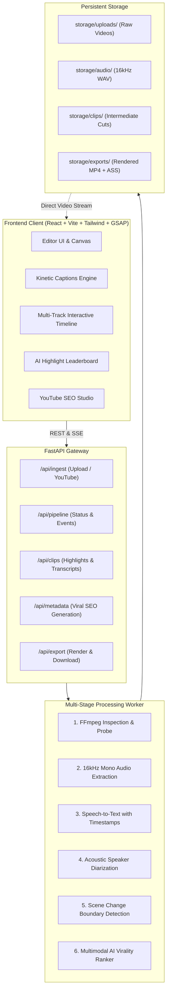

# AutoClip AI — System Architecture & Data Flow

AutoClip AI is an automated, multimodal video-clipping platform designed to ingest long-form media (podcasts, webinars, interviews, keynotes) and generate viral, short-form clips optimized for YouTube Shorts, Instagram Reels, and TikTok.

---

## 1. High-Level Architecture

---

## 2. Ingestion Engine

### User Video Uploads
- **Security Validation**: Files are checked against a strict MIME whitelist (`video/mp4`, `video/quicktime`, `video/webm`, `video/x-matroska`), magic bytes inspection (`ftyp`, `RIFF`, `EBML`), and a maximum file size cap (500 MB default).
- **Sanitization**: File names are sanitized to prevent directory traversal attacks (`../`, null bytes). Unique UUID prefixes prevent collisions.
- **Probe**: Ingested files are probed immediately using FFmpeg to establish duration, codec, fps, and dimensions.

### Authorized YouTube Ingestion
- **URL Schema Matching**: Supports standard watch links, youtu.be short links, and YouTube Shorts.
- **Restrictions Handling**:
  - Validates duration cap (3 hours max) to prevent memory exhaustion.
  - Detects age-restricted videos and DRM content with clear error messages.
  - Employs `yt-dlp` with automatic stream selection (`bestvideo[ext=mp4]+bestaudio[ext=m4a]/best`).

---

## 3. Pipeline Stages & Execution

1. **FFmpeg Probe (`probing`)**:
   - Queries stream information with `-show_entries stream=width,height,r_frame_rate,codec_name`.
2. **Audio Extraction (`audio_extract`)**:
   - Generates a 16-bit 16kHz single-channel WAV file (`-vn -acodec pcm_s16le -ar 16000 -ac 1`).
   - 16kHz mono is the standard format for speech recognition algorithms.
3. **Speech-to-Text (`stt`)**:
   - Produces word-level timestamps `[{ word, start, end, confidence }]`.
   - Supports OpenAI Whisper API, Gemini Multimodal, and a built-in acoustic VAD segmentation engine.
4. **Speaker Diarization (`diarize`)**:
   - Calculates spectral centroids and pitch variance across speech turns.
   - Assigns speaker labels (`Speaker 1`, `Speaker 2`) to enable dialogue bubbles and dual-speaker crops.
5. **Scene Boundary Detection (`scene_detect`)**:
   - Uses FFmpeg's scene change filter (`select='gt(scene,0.35)',showinfo`) to timestamp visual camera cuts.
6. **AI Virality Scoring (`highlight_ranking`)**:
   - Multi-factor algorithmic evaluation that ranks candidate 15s–60s windows by viral potential.

---

## 4. Frontend & Editor Architecture

- **React 19 & Vite**: Ultra-fast hot-reloading and lightweight production bundle.
- **Tailwind CSS**: Modern dark-mode video editor interface styled after Opus Clip and Descript.
- **GSAP (GreenSock Animation Platform)**:
  - Powers real-time kinetic karaoke subtitles on the video canvas.
  - Dynamically scales and bounces active spoken words with millisecond precision.
- **Aspect Ratio Preview**:
  - 9:16 Vertical Short (1080x1920).
  - 1:1 Square Feed (1080x1080).
  - 16:9 Landscape (1920x1080).
- **Multi-Track Timeline**:
  - Seconds ruler, interactive trim handles (`trimStart`, `trimEnd`), waveform representation, diarized speech bubble segments, and playhead scrubber.
